<picture>
  <source media="(prefers-color-scheme: dark)" srcset="https://raw.githubusercontent.com/zwordup-sudo/zwordup-sudo/gitascii/profiles/default/dark.svg">
  <source media="(prefers-color-scheme: light)" srcset="https://raw.githubusercontent.com/zwordup-sudo/zwordup-sudo/gitascii/profiles/default/light.svg">
  
</picture>

---

## [ FEATURED PROJECTS ]

*Building applications, developer tools & interactive experiences.*

| PROJECT | DESCRIPTION | STACK |
|:---|:---|:---|
| **[ASCII Motion Carousel](https://github.com/zwordup-sudo/ascii-motion-carousel)** | Local-first ASCII art generator with animated GIF exports. | TypeScript · React |
| **[FRYD](https://github.com/zwordup-sudo/FRYD)** | Productivity platform with tasks, habits, analytics and AI integration. | React · Python · FastAPI |
| **[Hercules](https://github.com/zwordup-sudo/Hercules)** | Offline Android workout tracking application. | Kotlin · Jetpack Compose |
| **[BotArena](https://github.com/zwordup-sudo/BotArena)** | Modular robot combat game with customizable equipment and abilities. | Godot · GDScript |
| **[Loto Blanco](https://github.com/zwordup-sudo/loto-blanco)** | Two-player English checkers with an independent rules engine. | JavaScript · Vite |

---

`> Explore the repositories. More projects in development.`
