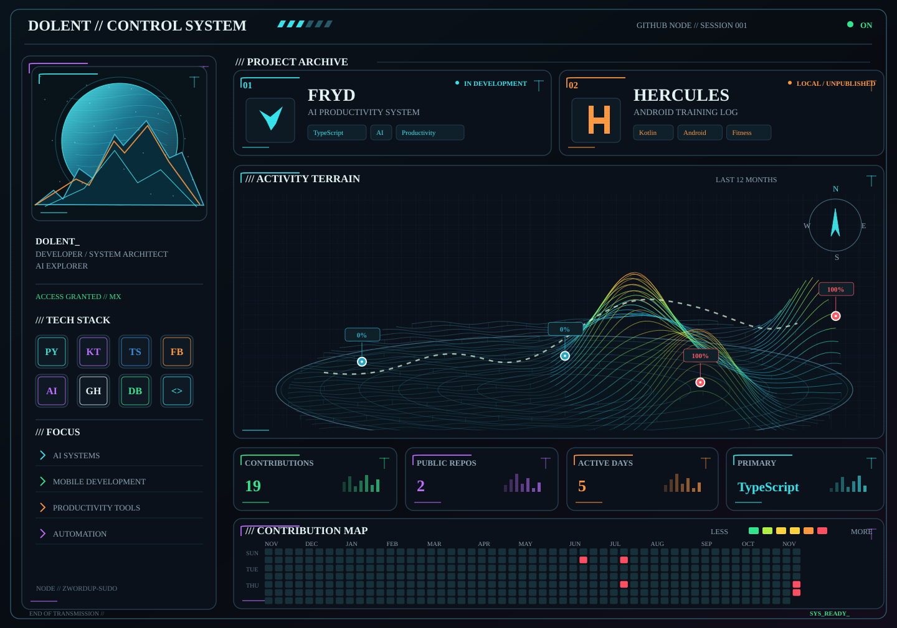

<!-- DOLENT / Developer dashboard; activity graphic is auto-updated -->

  <a href="https://github.com/zwordup-sudo/FRYD"><b>01 // FRYD · AI Productivity System</b></a>
  &nbsp; | &nbsp;
  <b>02 // HERCULES · Android Fitness App (local)</b>

<code>AI systems</code> &nbsp; <code>Android</code> &nbsp; <code>Productivity</code> &nbsp; <code>Automation</code>

STATUS: ONLINE · Activity graphic updated through GitHub Actions

